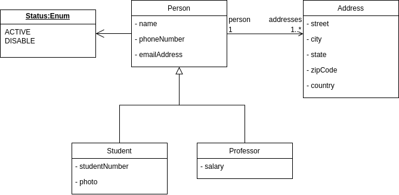

<h1 align="center">
  TI - Sistema de Gestão Acadêmico
</h1>

<p align="center">
 
</p>

Desafio proposto pelo [Grupo Educacional Bom Jesus](https://bomjesus.br/quem-somos) com o objetivo de nivelar o conhecimento em Java e Spring Boot.

O projeto é um CRUD (Create, Read, Update, Delete) de **alunos** e **professores**, com seus endereços, construído com Spring Boot e focado em APIs REST. Inclui validação dos dados, tratamento padronizado de erros, documentação com Swagger e testes unitários.

<h2 align="left">Tecnologias utilizadas</h2>

* Java
* Spring Boot (Web, Data JPA, Validation)
* Banco de dados relacional (configurável)
* Lombok
* Swagger / OpenAPI (springdoc)
* JUnit 5 e Mockito
* Maven
* Git e GitHub

## Instalação

Clone o [repositório](https://github.com/TharlisSampaio/desafio_crud_bom_jesus.git). O projeto usa banco de dados em memória (H2), então não é necessário configurar nada. Os dados são perdidos quando a aplicação é reiniciada:

```
git clone https://github.com/TharlisSampaio/desafio_crud_bom_jesus.git
```

Se não quiser usar banco de dados em memória. Após clonar, configure a conexão com o banco de dados no arquivo `src/main/resources/application.properties`. Exemplo com PostgreSQL:

```properties
spring.datasource.url=jdbc:postgresql://localhost:5432/bom_jesus
spring.datasource.username=seu_usuario
spring.datasource.password=sua_senha
spring.jpa.hibernate.ddl-auto=update
```

As tabelas são criadas automaticamente na primeira execução.

## Executando com Docker

É necessário gerar o `.jar` antes de construir a imagem:

```
./mvnw clean package
docker build -t bom-jesus-api .
docker run -p 8080:8080 bom-jesus-api
```

A API sobe em `http://localhost:8080` e o Swagger em `http://localhost:8080/swagger-ui.html`.

## Executando

```
./mvnw spring-boot:run
```

A aplicação sobe em `http://localhost:8080`.

## Testes

```
./mvnw test
```

Os testes unitários cobrem as camadas de service (JUnit 5 + Mockito) e as regras de cadastro, consulta, atualização e desativação.

## Modelagem

Diagrama base do desafio:

<p align="center">
 
</p>

Decisões de implementação:

* **Herança:** `Student` e `Teacher` herdam de `Person` (estratégia `JOINED`: uma tabela por classe, ligadas pelo mesmo `id`).
* **Endereços:** cada pessoa possui um ou mais endereços (`1..*`). Os endereços são salvos e removidos junto com a pessoa.
* **Status:** enum `ACTIVE` / `DISABLE`. Toda pessoa nasce `ACTIVE`.
* **Exclusão lógica:** o `DELETE` não apaga o registro, apenas altera o status para `DISABLE`.
* **DTOs:** a API recebe e devolve DTOs (`Request` / `Response`), nunca as entidades.

## Documentação da API

Os endpoints podem ser consultados e testados pelo Swagger:

```
http://localhost:8080/swagger-ui.html
```

## Endpoints

### Alunos (`/students`)

| Método | Rota | Descrição | Resposta |
|---|---|---|---|
| `POST` | `/students` | Cadastra um aluno com seus endereços | `201 Created` |
| `GET` | `/students` | Lista todos os alunos | `200 OK` |
| `GET` | `/students/{id}` | Busca um aluno pelo id | `200 OK` / `404 Not Found` |
| `PUT` | `/students/{id}` | Atualiza nome, contato, matrícula e foto | `200 OK` / `404 Not Found` |
| `DELETE` | `/students/{id}` | Desativa o aluno (`status = DISABLE`) | `204 No Content` / `404 Not Found` |

### Professores (`/teachers`)

| Método | Rota | Descrição | Resposta |
|---|---|---|---|
| `POST` | `/teachers` | Cadastra um professor com seus endereços | `201 Created` |
| `GET` | `/teachers` | Lista todos os professores | `200 OK` |
| `GET` | `/teachers/{id}` | Busca um professor pelo id | `200 OK` / `404 Not Found` |
| `PUT` | `/teachers/{id}` | Atualiza nome, contato e salário | `200 OK` / `404 Not Found` |
| `DELETE` | `/teachers/{id}` | Desativa o professor (`status = DISABLE`) | `204 No Content` / `404 Not Found` |

### Exemplo: `POST /students`

Requisição:

```json
{
  "name": "Maria Silva",
  "phoneNumber": "41999999999",
  "emailAddress": "maria.silva@email.com",
  "studentNumber": "2024001",
  "addresses": [
    {
      "street": "Rua das Flores, 100",
      "city": "Curitiba",
      "state": "PR",
      "zipCode": "80000-000",
      "country": "Brasil"
    }
  ]
}
```

Resposta (`201 Created`):

```json
{
  "id": 1,
  "name": "Maria Silva",
  "phoneNumber": "41999999999",
  "emailAddress": "maria.silva@email.com",
  "status": "ACTIVE",
  "studentNumber": "2024001",
  "hasPhoto": false,
  "addresses": [
    {
      "id": 1,
      "street": "Rua das Flores, 100",
      "city": "Curitiba",
      "state": "PR",
      "zipCode": "80000-000",
      "country": "Brasil"
    }
  ]
}
```

### Exemplo: `POST /teachers`

```json
{
  "name": "João Pereira",
  "phoneNumber": "41988888888",
  "emailAddress": "joao.pereira@email.com",
  "salary": 5500.00,
  "addresses": [
    {
      "street": "Av. Sete de Setembro, 2500",
      "city": "Curitiba",
      "state": "PR",
      "zipCode": "80230-010",
      "country": "Brasil"
    }
  ]
}
```
## Front-end (diferencial)

Além da API, foi desenvolvido um front-end em Angular que consome os endpoints de alunos e professores:

**[bom_jesus_app](https://github.com/TharlisSampaio/bom_jesus_app)**

Para usá-lo, suba esta API primeiro (porta `8080`) e siga as instruções de execução do repositório do front-end (`ng serve`, em `http://localhost:4200`).

## Tratamento de erros

Os erros seguem um formato padronizado:

| Situação | Status |
|---|---|
| Dados inválidos (campo em branco, e-mail inválido, nenhum endereço) | `400 Bad Request` |
| JSON malformado | `400 Bad Request` |
| Registro não encontrado | `404 Not Found` |
| Dado duplicado (ex.: matrícula já cadastrada) | `409 Conflict` |

Exemplo de resposta `400`:

```json
{
  "timestamp": "2026-10-18T15:30:00",
  "status": 400,
  "message": "Dados inválidos",
  "fieldErrors": {
    "emailAddress": "deve ser um endereço de e-mail bem formado",
    "addresses": "não deve estar vazio"
  }
}
```